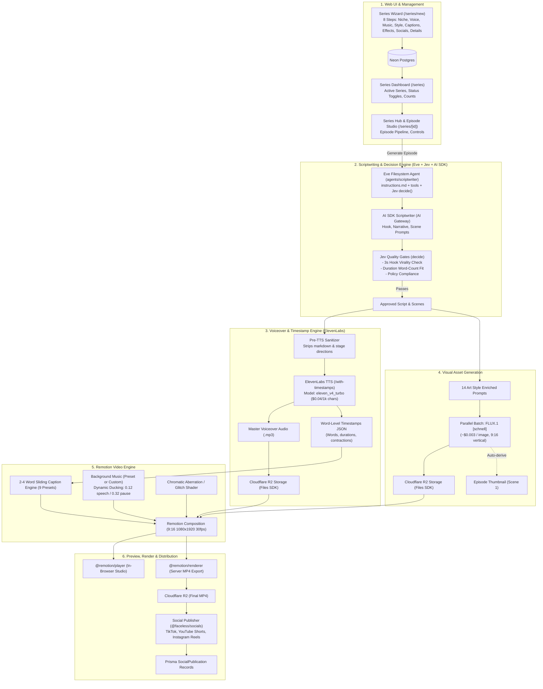

# Master Plan: Automated Faceless Video Platform

This directory contains the step-by-step engineering roadmap for building out the end-to-end `/series` feature on the Faceless platform.

---

## Architecture Diagram

---

## Phase Breakdown

| Document | Phase | Key Objective |
| :-- | :-- | :-- |
| [Phase 1](file:///Users/dzulhelmy/Desktop/faceless/plan/phase-1-routes-and-series-dashboard.md) | **Routing & Series Dashboard** | Relocate wizard to `/series/new`, build `/series` dashboard list & `/series/[id]` management hub. |
| [Phase 2](file:///Users/dzulhelmy/Desktop/faceless/plan/phase-2-eve-jev-scriptwriting-engine.md) | **Eve, Jev & AI SDK Engine** | Filesystem-first agent in `@faceless/agent` (`packages/agent`), virality & duration gates via Jev `decide()`. |
| [Phase 3](file:///Users/dzulhelmy/Desktop/faceless/plan/phase-3-elevenlabs-tts-word-timestamps.md) | **ElevenLabs Voiceover & Timestamps** | `eleven_v4_turbo` synthesis, pre-TTS sanitization, zero-migration `SeriesEpisodeMetadata`, R2 storage. |
| [Phase 4](file:///Users/dzulhelmy/Desktop/faceless/plan/phase-4-visual-assets-generation.md) | **Visual Asset Generation Pipeline** | 14 curated styles matched to contracts, parallel FLUX.1 [schnell] batching, `SeriesEpisodeScene` model. |
| [Phase 5](file:///Users/dzulhelmy/Desktop/faceless/plan/phase-5-remotion-video-composition.md) | **Remotion Video Composition** | 9:16 layout, 2–4 word sliding captions (9 presets), Ken Burns motion, dynamic audio ducking, glitch FX. |
| [Phase 6](file:///Users/dzulhelmy/Desktop/faceless/plan/phase-6-episode-studio-and-web-player.md) | **In-Browser Episode Studio** | Real-time scrubbing with `@remotion/player`, live style switching, single-scene prompt regeneration. |
| [Phase 7](file:///Users/dzulhelmy/Desktop/faceless/plan/phase-7-server-rendering-and-social-publishing.md) | **Server Rendering & Social Publishing** | `@remotion/renderer` MP4 export, `/api/cron/publish`, and multi-platform posting via existing `@faceless/socials`. |

---

## Key Architectural Decisions (Grill-Me Outcomes)

Through an exhaustive `/grill-me` architectural review, the following 11 core design decisions have been locked:

| Area | Decision | Rationale |
| :-- | :-- | :-- |
| **1. Routing Architecture** | Dedicated routes: `/series` (Dashboard), `/series/new` (Wizard), `/series/[id]` (Hub), `/series/[id]/episodes/[episodeId]` (Studio). | Clean separation of concerns; empty state on `/series` guides first-time users to `/series/new`. |
| **2. Generation Policy** | Hybrid with "Auto-Pilot" toggle in Series settings. | Default requires manual review in Studio (`READY_FOR_REVIEW`); turning Auto-Pilot ON enables 100% autonomous post-and-publish. |
| **3. Topic Deduplication** | Autonomous topic ideation checking past DB titles, plus optional manual override. | Keeps the series fresh and non-repetitive while allowing creator intervention whenever desired. |
| **4. Render Timing** | Pre-render MP4 immediately upon `APPROVED` status. | Video is uploaded and CDN-ready ahead of time, ensuring instant release at exact `publishTime`. |
| **5. Publishing Failures** | Independent platform status in `SocialPublication`, up to 3 automatic retries, in-UI retry button. | Isolates platform-specific network hiccups without failing the entire publication run. |
| **6. Schedule Lead Time** | Pipeline triggers 2 hours prior to `publishTime` (e.g. at 10:00 AM for a 12:00 PM release). | Gives creators ample time to review and tweak before the scheduled broadcast. |
| **7. Series Deletion** | Soft delete (`ARCHIVED` status) with unarchive capability. | Stops recurring crons while preserving historical episode analytics, published links, and media assets. |
| **8. Wizard Drafts** | Scoped `localStorage` draft restore with reset indicator at `/series/new`. | Protects creator from losing multi-step wizard choices on accidental reload or browser crash. |
| **9. Asset Regeneration** | Granular on-demand: modifying text/prompts marks scene as "Stale" with single-click scene re-gen buttons. | Eliminates unnecessary API spend by only re-synthesizing affected audio or image segments. |
| **10. Video Rendering** | `VideoRendererService` adapter pattern (Direct `@remotion/renderer` local, swappable for `@remotion/lambda`). | Enables frictionless local testing while cleanly separating compute scaling for production. |
| **11. Quota & Credits** | Reserve 1 credit at generation start; auto-refund upon fatal pipeline failure. | Fair billing model that prevents double-charging creators on third-party API outages. |

---

## Tech Stack & Core Dependencies

| Domain | Technology / Service | Role |
| :-- | :-- | :-- |
| **Framework** | Next.js 15 (App Router), React 19 | Frontend web app, server actions, API routes |
| **RPC & State** | tRPC v11, TanStack Query v5, `nuqs` | Type-safe client-server contract, query caching, URL state |
| **Styling** | Tailwind CSS v4, Lucide Icons | Responsive modern UI |
| **Quality & Lint** | Ultracite (Oxlint + Oxfmt) | Zero-config linting & formatting standards |
| **Database** | Prisma 7 + Neon PostgreSQL | Relational schemas (`Series`, `SeriesEpisode`, `SeriesEpisodeScene`, `SocialPublication`) |
| **Storage** | Cloudflare R2 via `@faceless/storage` (Files SDK) | Audio clips, scene images, final rendered MP4s with public CDN streaming |
| **AI LLM** | Vercel AI SDK + Vercel AI Gateway (`AI_GATEWAY_API_KEY`) | Dynamic model routing (GPT-4o, Claude 3.5, Flash) |
| **Durable Agents** | Eve (`eve.dev`) & Jev (`typesafe-ai/jev`) | Filesystem-first agent directory and LLM quality decision gates (`decide`) |
| **Voice TTS** | ElevenLabs API (`eleven_v4_turbo`) | High-speed TTS with character/word alignment JSON ($0.04 / 1k chars) |
| **Image Gen** | FLUX.1 [schnell] via AI Gateway | Ultra-fast 9:16 scene keyframe generation (~$0.003 / image) |
| **Video Engine** | Remotion (`@remotion/core`, `@remotion/player`, `@remotion/renderer`) | Programmatic React-based video generation & in-browser live preview |
| **Socials** | `@faceless/socials` (`@opencoredev/social-sdk`) | OAuth-authenticated upload to TikTok, YouTube Shorts, Instagram Reels |
