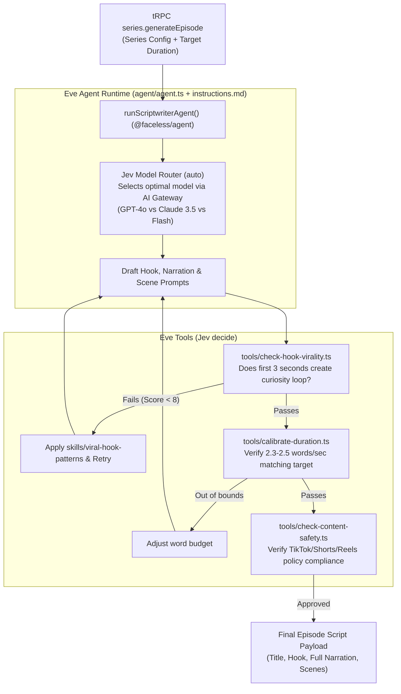

# Phase 2: Eve, Jev & AI SDK Scriptwriting Engine

## 1. Goal & Objectives

Implement an autonomous, durable AI scriptwriting package (`@faceless/agent` in `packages/agent`) adhering to the **Eve (`eve.dev`)** filesystem-first framework, **Jev (`typesafe-ai/jev`)** decision gates, and native Next.js integration via **`withEve` from `eve/next`**.

The agent generates high-retention short-form video scripts, viral hooks, and scene descriptions tailored to the user's `nichePrompt` and `exampleScript`, validated through typed quality gates before triggering audio/video generation.

---

## 2. Monorepo Package & Eve Filesystem Agent Structure

To integrate cleanly with Turborepo and Next.js, the agent lives in **`packages/agent/`** (`@faceless/agent`):

```
packages/agent/
├── package.json                 # { "name": "@faceless/agent", "dependencies": { "eve": "..." } }
├── tsconfig.json
├── src/
│   └── index.ts                 # Typed export: runScriptwriterAgent(input)
└── agent/                       # Canonical Eve Agent Root
    ├── agent.ts                 # Runtime config (AI Gateway, Jev model routing)
    ├── instructions.md          # Master role prompt, retention rules & constraints
    ├── tools/                   # Auto-discovered TypeScript tools
    │   ├── check-hook-virality.ts   # Jev decide() virality gate
    │   ├── calibrate-duration.ts    # Word count & spoken timing validator
    │   └── check-content-safety.ts  # Platform policy & moderation gate
    └── skills/                  # Playbooks loaded dynamically on demand
        ├── viral-hook-patterns.md   # Pattern interrupts, curiosity loops, anti-clichés
        └── short-form-pacing.md     # 2.3-2.5 words/sec calibration rules
```

---

## 3. Native Next.js Integration (`withEve` from `eve/next`)

As specified in [eve.dev/docs/guides/frontend/nextjs](https://eve.dev/docs/guides/frontend/nextjs), Eve integrates natively into Next.js via `withEve`:

### Configuration (`apps/web/next.config.ts`)

`withEve` wraps `nextConfig` and composes with `withVarlock`, pointing `eveRoot` to `../../packages/agent`:

```ts
import { varlockNextConfigPlugin } from "@varlock/nextjs-integration/plugin";
import { withEve } from "eve/next";
import type { NextConfig } from "next";

const withVarlock = varlockNextConfigPlugin();

const nextConfig: NextConfig = {
  cacheComponents: true,
  output: "standalone",
  partialPrefetching: true,
  reactCompiler: true,
  transpilePackages: [
    "@faceless/agent",
    "@faceless/api",
    "@faceless/auth",
    "@faceless/contracts",
    "@faceless/db",
    "@faceless/email",
    "@faceless/storage",
    "@faceless/ui",
    "@faceless/utils",
  ],
};

export default withVarlock(
  withEve(nextConfig, {
    eveRoot: "../../packages/agent",
  })
);
```

### What `withEve` Unlocks:

- **Single Dev Command (`bun run dev`)**: Automatically boots the Eve runtime alongside Next.js and rewrites same-origin `/eve/v1/*` routes.
- **Single Vercel Project**: Next.js and the Eve agent compile and deploy as one cohesive Vercel project with zero proxy boilerplate.
- **Automated Vercel Crons**: Any Eve schedules are automatically registered as Vercel Cron Jobs on deploy.
- **Browser & Server Interop**: Allows both server-side execution via tRPC and optional direct browser streaming with `useEveAgent()` from `eve/react`.

---

## 4. Architecture & Decision Flow



---

## 5. API Router Integration (`packages/api/src/routers/series.ts`)

1. Add `@faceless/agent` as a dependency in `packages/api/package.json`:
   ```json
   "dependencies": {
     "@faceless/agent": "workspace:*"
   }
   ```
2. Execute the agent in `series.generateEpisode`:
   ```ts
   import { runScriptwriterAgent } from "@faceless/agent";

   generateEpisode: protectedProcedure
     .input(generateEpisodeInputSchema)
     .mutation(async ({ ctx, input }) => {
       const series = await ctx.db.series.findUniqueOrThrow({
         where: { id: input.seriesId, userId: ctx.session.user.id },
       });

       // Fetch previous episode titles to prevent duplicate story angles
       const previousEpisodes = await ctx.db.seriesEpisode.findMany({
         where: { seriesId: series.id },
         select: { title: true, topic: true },
         orderBy: { createdAt: "desc" },
         take: 20,
       });

       // Execute Eve scriptwriter agent
       const script = await runScriptwriterAgent({
         nichePrompt: series.nichePrompt,
         exampleScript: series.exampleScript,
         language: series.language,
         duration: series.videoDuration,
         artStyleId: series.artStyleId,
         topicOverride: input.topicOverride,
         previousTitles: previousEpisodes.map((e) => e.title),
       });

       // Create episode in Neon DB with status "GENERATING"
       const episode = await ctx.db.seriesEpisode.create({
         data: {
           seriesId: series.id,
           title: script.title,
           status: "GENERATING",
         },
       });

       return { episodeId: episode.id, script };
     }),
   ```

---

## 6. Detailed Component Plan

### A. Agent Runtime (`packages/agent/agent/agent.ts`)

- Uses unified `AI_GATEWAY_API_KEY`.
- Leverages Jev `auto()` for smart routing:
  - Deep narrative / psychological thrillers $\rightarrow$ `openai/gpt-4o` or `anthropic/claude-3-5-sonnet-20241022`.
  - Fast straightforward scripts $\rightarrow$ `openai/gpt-4o-mini` or `google/gemini-2.0-flash`.

### B. Agent Instructions (`packages/agent/agent/instructions.md`)

- **Role**: World-class short-form video retention specialist and scriptwriter.
- **Constraints**:
  - Never open with rhetorical questions like _"Did you know..."_ or _"Have you ever wondered..."_.
  - Use immediate high-stakes pattern interrupts in the first 3 seconds (e.g. _"Historians were horrified when they opened this tomb..."_).
  - Break narration into 3 to 6 distinct visual scenes with 9:16 vertical prompt descriptions matching `artStyleId`.

### C. Jev Quality Decision Tools (`packages/agent/agent/tools/`)

1. **`check-hook-virality.ts`**:
   - Uses Jev's `decide()`:
     ```ts
     import { decide } from "typesafe-ai/jev";

     export default async function checkHookVirality({
       hook,
     }: {
       hook: string;
     }) {
       return await decide({
         criteria:
           "Does this opening line establish an immediate high-stakes curiosity gap within the first 3 seconds?",
         content: hook,
       });
     }
     ```
2. **`calibrate-duration.ts`**:
   - Speaking pace: $2.3$ to $2.5$ words per second.
   - `30-40s` video: $75 - 95$ total words.
   - `60-70s` video: $140 - 170$ total words.
3. **`check-content-safety.ts`**:
   - Scans narrative for terms that trigger automated shadowbans or demonetization on TikTok, YouTube, and Meta.

### D. Structured Output Schema (`packages/contracts/src/series.ts`)

```ts
export const episodeSceneSchema = z.object({
  sceneNumber: z.number().int().min(1),
  narrationChunk: z.string().min(1),
  visualPrompt: z.string().min(10), // Enriched prompt for FLUX/SDXL 9:16
  estimatedSeconds: z.number().positive(),
});

export const generatedScriptPayloadSchema = z.object({
  title: z.string().min(1).max(100),
  hook: z.string().min(5).max(200),
  fullNarration: z.string().min(50),
  scenes: z.array(episodeSceneSchema).min(3),
  targetDurationSeconds: z.number().int(),
  viralityScore: z.number().min(1).max(10),
  reasoning: z.string(),
});

export type GeneratedScriptPayload = z.infer<
  typeof generatedScriptPayloadSchema
>;
```

---

## 7. Implementation Checklist

- [ ] Create `packages/agent` workspace package (`@faceless/agent`).
- [ ] Install `eve` in `packages/agent` and `apps/web`.
- [ ] Wrap `apps/web/next.config.ts` with `withEve(nextConfig, { eveRoot: "../../packages/agent" })`.
- [ ] Scaffold `packages/agent/agent/` with `instructions.md` and `agent.ts`.
- [ ] Implement `packages/agent/agent/tools/` (`check-hook-virality.ts`, `calibrate-duration.ts`, `check-content-safety.ts`).
- [ ] Create `packages/agent/agent/skills/` playbooks.
- [ ] Add `episodeSceneSchema` and `generatedScriptPayloadSchema` to `@faceless/contracts/series`.
- [ ] Add `@faceless/agent` dependency to `packages/api` and wire `runScriptwriterAgent`.
- [ ] Run `bunx ultracite check` and `bun run check-types` to ensure zero regressions.
