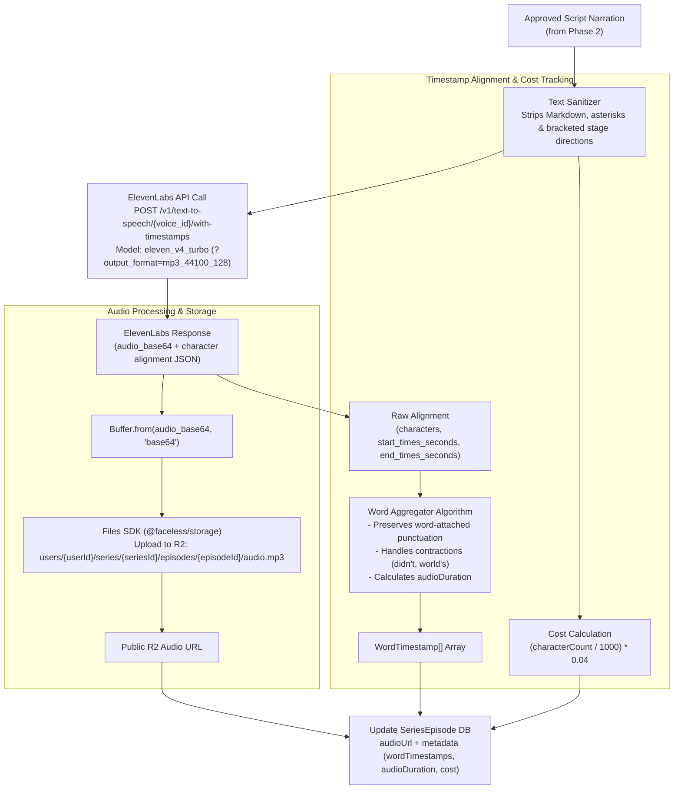

# Phase 3: ElevenLabs Voiceover & Word-Level Timestamps

## 1. Goal & Objectives

Synthesize natural narration voiceovers using **ElevenLabs** exclusively with the high-speed, cost-efficient model **`eleven_v4_turbo`** ($0.04 / 1,000 characters). Extract exact character-to-word timestamps from ElevenLabs `/v1/text-to-speech/{voice_id}/with-timestamps` to power synchronized animated captions in Remotion, pre-sanitize script text to eliminate unwanted stage directions, calculate generation costs, and persist audio assets directly to Cloudflare R2 via `@faceless/storage` (Files SDK).

---

## 2. ElevenLabs Integration Architecture



---

## 3. Detailed Component Plan

### A. Pre-TTS Script Sanitizer (`packages/api/src/services/ai/text-sanitizer.ts`)

LLMs often insert stage directions or markdown formatting into narration:

> _"\[Dramatic pause\] Deep inside the tomb... \*whispering\* something stirred."_

If passed untreated, ElevenLabs will speak _"bracket dramatic pause bracket"_ or _"asterisk whispering asterisk"_. The sanitizer strips these artifacts:

```ts
export function sanitizeNarrationForTts(rawText: string): string {
  return (
    rawText
      // Remove bracketed stage directions: [Dramatic pause], (sighs), [whispering]
      .replace(/\[.*?\]|\(.*?\)/g, "")
      // Remove markdown headers, bold, italics, quotes
      .replace(/[#*_~`>]/g, "")
      // Normalize multiple spaces and newlines
      .replace(/\s+/g, " ")
      .trim()
  );
}
```

---

### B. ElevenLabs Client (`packages/api/src/services/elevenlabs.ts`)

- **Target Endpoint**: `https://api.elevenlabs.io/v1/text-to-speech/{voice_id}/with-timestamps?output_format=mp3_44100_128`
- **Headers**:
  - `xi-api-key`: `process.env.ELEVENLABS_API_KEY`
  - `Content-Type`: `application/json`
- **Request Payload**:
  ```json
  {
    "text": "Cleaned voiceover text...",
    "model_id": "eleven_v4_turbo",
    "voice_settings": {
      "stability": 0.5,
      "similarity_boost": 0.75,
      "style": 0.0,
      "use_speaker_boost": true
    }
  }
  ```
- **Response Decoding**:
  ```ts
  const data = await response.json();
  const audioBuffer = Buffer.from(data.audio_base64, "base64");
  ```

---

### C. Word Timestamp Aggregation Algorithm

ElevenLabs returns character-level timestamps:

```ts
interface RawElevenLabsAlignment {
  characters: string[];
  character_start_times_seconds: number[];
  character_end_times_seconds: number[];
}
```

The aggregator groups characters into words, preserving attached punctuation and apostrophe contractions:

```ts
export interface WordTimestamp {
  word: string;
  start: number; // in seconds (e.g. 0.45)
  end: number; // in seconds (e.g. 0.89)
}

export interface ParsedAudioAlignment {
  words: WordTimestamp[];
  audioDuration: number;
}

export function parseAlignmentToWords(
  alignment: RawElevenLabsAlignment
): ParsedAudioAlignment {
  const words: WordTimestamp[] = [];
  let currentWord = "";
  let wordStart = 0;
  let wordEnd = 0;

  for (let i = 0; i < alignment.characters.length; i++) {
    const char = alignment.characters[i];
    const start = alignment.character_start_times_seconds[i];
    const end = alignment.character_end_times_seconds[i];

    if (char === " " || char === "\n") {
      if (currentWord.trim().length > 0) {
        words.push({
          word: currentWord.trim(),
          start: wordStart,
          end: wordEnd,
        });
        currentWord = "";
      }
    } else {
      if (currentWord.length === 0) {
        wordStart = start;
      }
      currentWord += char;
      wordEnd = end;
    }
  }

  if (currentWord.trim().length > 0) {
    words.push({ word: currentWord.trim(), start: wordStart, end: wordEnd });
  }

  const audioDuration =
    alignment.character_end_times_seconds.length > 0
      ? alignment.character_end_times_seconds[
          alignment.character_end_times_seconds.length - 1
        ]
      : 0;

  return { words, audioDuration };
}
```

---

### D. Asset Storage via Files SDK (`@faceless/storage`)

Using tenant-isolated Cloudflare R2 pathing:

```ts
const storagePath = `users/${userId}/series/${seriesId}/episodes/${episodeId}/audio.mp3`;

await files.upload(storagePath, audioBuffer, {
  contentType: "audio/mpeg",
});

const audioUrl = await files.url(storagePath);
```

_Note: Public streaming via `R2_PUBLIC_BASE_URL` allows `@remotion/player` and `@remotion/renderer` to stream the audio without URL expiration._

---

## 4. Zero-Migration Database Persistence (`SeriesEpisode.metadata`)

The current `SeriesEpisode` Prisma model already provides `audioUrl: String?` and `metadata: Json?`. We avoid disruptive migrations by defining a typed contract in `@faceless/contracts/series`:

```ts
export interface SeriesEpisodeMetadata {
  audioKey: string;
  audioDuration: number;
  wordTimestamps: WordTimestamp[];
  characterCount: number;
  generationCostUsd: number; // (characterCount / 1000) * 0.04
}
```

When saving to the database:

```ts
await ctx.db.seriesEpisode.update({
  where: { id: episodeId },
  data: {
    audioUrl,
    metadata: {
      audioKey: storagePath,
      audioDuration,
      wordTimestamps: words,
      characterCount: cleanText.length,
      generationCostUsd: (cleanText.length / 1000) * 0.04,
    },
  },
});
```

---

## 5. Implementation Checklist

- [ ] Add `ELEVENLABS_API_KEY` to `apps/web/.env.schema` and run `bun run env:generate`.
- [ ] Implement `sanitizeNarrationForTts` utility with unit tests for bracket/markdown removal.
- [ ] Implement `packages/api/src/services/elevenlabs.ts` calling `/with-timestamps` with `eleven_v4_turbo`.
- [ ] Implement `parseAlignmentToWords` and duration extraction.
- [ ] Add `SeriesEpisodeMetadata` and `WordTimestamp` types to `@faceless/contracts/series`.
- [ ] Wire audio buffer upload to Cloudflare R2 via `@faceless/storage`.
- [ ] Persist `audioUrl` and typed `metadata` to `SeriesEpisode`.
- [ ] Run `bunx ultracite check` and `bun run check-types` to ensure zero errors.
