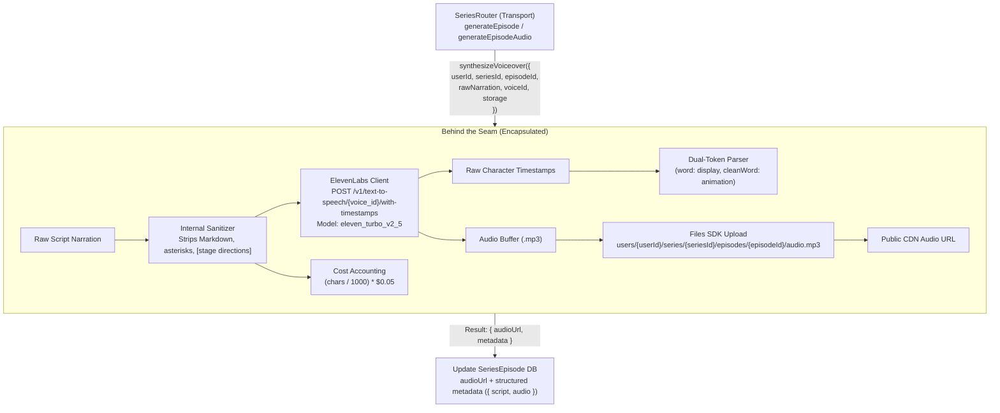

# Phase 3: ElevenLabs Voiceover & Word-Level Timestamps

## 1. Goal & Objectives

Synthesize natural narration voiceovers using **ElevenLabs** exclusively with the high-speed, cost-efficient multilingual model **`eleven_turbo_v2_5`** ($0.05 / 1,000 characters; ~0.5 credits/char). Extract exact character-to-word timestamps from ElevenLabs `/v1/text-to-speech/{voice_id}/with-timestamps` to power synchronized animated captions in Remotion, pre-sanitize script text to eliminate unwanted stage directions, calculate generation costs, and persist audio assets directly to Cloudflare R2 via `@faceless/storage` (Files SDK).

In accordance with our architecture review, Phase 3 implements a **Deep Voiceover Module** (`packages/api/src/services/voiceover/index.ts`) that absorbs text sanitization, ElevenLabs HTTP dispatch, dual-token alignment parsing, R2 persistence, and cost calculations behind a single, high-leverage interface.

---

## 2. Voiceover Module Architecture



---

## 3. Deep Module Interface & Specifications

### A. Deep Module Public Interface (`packages/api/src/services/voiceover/index.ts`)

Callers in the transport router interact with a single, high-leverage interface:

```ts
import type { SeriesEpisodeAudioMetadata } from "@faceless/contracts/series";
import type { Files } from "files-sdk";

export interface SynthesizeVoiceoverInput {
  userId: string;
  seriesId: string;
  episodeId: string;
  rawNarration: string;
  voiceId: string;
  storage: Files;
}

export interface SynthesizeVoiceoverOutput {
  audioUrl: string;
  audioKey: string;
  metadata: SeriesEpisodeAudioMetadata;
}

export const synthesizeVoiceover = async (
  input: SynthesizeVoiceoverInput
): Promise<SynthesizeVoiceoverOutput> => {
  // 1. Sanitize narration text
  const cleanNarration = sanitizeNarration(input.rawNarration);

  // 2. Dispatch to ElevenLabs /with-timestamps (eleven_turbo_v2_5)
  const { audioBuffer, rawAlignment } = await requestElevenLabsTts({
    text: cleanNarration,
    voiceId: input.voiceId,
  });

  // 3. Parse dual-token word timestamps
  const { words, audioDuration } = parseAlignmentToWords(rawAlignment);

  // 4. Persist to Cloudflare R2
  const audioKey = `users/${input.userId}/series/${input.seriesId}/episodes/${input.episodeId}/audio.mp3`;
  await input.storage.upload(audioKey, audioBuffer, {
    contentType: "audio/mpeg",
  });
  const audioUrl = await input.storage.url(audioKey);

  // 5. Account for generation costs ($0.05 / 1k chars)
  const generationCostUsd = Number(
    ((cleanNarration.length / 1000) * 0.05).toFixed(4)
  );

  return {
    audioUrl,
    audioKey,
    metadata: {
      audioKey,
      audioDuration,
      wordTimestamps: words,
      characterCount: cleanNarration.length,
      generationCostUsd,
      voiceId: input.voiceId,
      modelId: "eleven_turbo_v2_5",
    },
  };
};
```

---

### B. Absorbed Text Sanitizer (`packages/api/src/services/voiceover/sanitizer.ts`)

Internal helper that strips markdown and bracketed/parenthetical stage directions so ElevenLabs does not verbalize them:

```ts
export const sanitizeNarration = (rawText: string): string => {
  return (
    rawText
      // Remove bracketed/parenthetical stage directions: [Dramatic pause], (sighs), [whispering]
      .replace(/\[.*?\]|\(.*?\)/gu, "")
      // Remove markdown headers, bold, italics, quotes, backticks
      .replace(/[#*_~`>]/gu, "")
      // Normalize multiple spaces and newlines
      .replace(/\s+/gu, " ")
      .trim()
  );
};
```

---

### C. Absorbed Dual-Token Word Timestamp Parser (`packages/api/src/services/voiceover/alignment.ts`)

Transforms ElevenLabs character-level timings into dual-token `word` (with punctuation for screen display) and `cleanWord` (punctuation-stripped for keyword animation sync):

```ts
export interface RawElevenLabsAlignment {
  characters: string[];
  character_start_times_seconds: number[];
  character_end_times_seconds: number[];
}

export interface WordTimestamp {
  word: string; // Natural with attached punctuation for display (e.g. "unsolved,")
  cleanWord: string; // Stripped for keyword highlight & animation (e.g. "unsolved")
  start: number; // seconds
  end: number; // seconds
}

export interface ParsedAudioAlignment {
  words: WordTimestamp[];
  audioDuration: number;
}

const PUNCTUATION_CLEAN_REGEX = /^[^\p{L}\p{N}]+|[^\p{L}\p{N}]+$/gu;

export const parseAlignmentToWords = (
  alignment: RawElevenLabsAlignment
): ParsedAudioAlignment => {
  const words: WordTimestamp[] = [];
  let currentWord = "";
  let wordStart = 0;
  let wordEnd = 0;

  for (let i = 0; i < alignment.characters.length; i++) {
    const char = alignment.characters[i];
    const start = alignment.character_start_times_seconds[i];
    const end = alignment.character_end_times_seconds[i];

    if (char === " " || char === "\n") {
      if (currentWord.trim().length > 0) {
        const trimmed = currentWord.trim();
        const clean = trimmed.replaceAll(PUNCTUATION_CLEAN_REGEX, "");

        words.push({
          word: trimmed,
          cleanWord: clean.length > 0 ? clean : trimmed,
          start: wordStart,
          end: wordEnd,
        });
        currentWord = "";
      }
    } else {
      if (currentWord.length === 0) {
        wordStart = start;
      }
      currentWord += char;
      wordEnd = end;
    }
  }

  if (currentWord.trim().length > 0) {
    const trimmed = currentWord.trim();
    const clean = trimmed.replaceAll(PUNCTUATION_CLEAN_REGEX, "");

    words.push({
      word: trimmed,
      cleanWord: clean.length > 0 ? clean : trimmed,
      start: wordStart,
      end: wordEnd,
    });
  }

  const audioDuration =
    alignment.character_end_times_seconds.length > 0
      ? (alignment.character_end_times_seconds[
          alignment.character_end_times_seconds.length - 1
        ] ?? 0)
      : 0;

  return { words, audioDuration };
};
```

---

## 4. Structured Namespace Database Persistence (`SeriesEpisode.metadata`)

The `SeriesEpisode` Prisma model provides `audioUrl: String?` and `metadata: Json?`. Contracts define typed structured namespaces in `@faceless/contracts/series`:

```ts
export interface SeriesEpisodeAudioMetadata {
  audioKey: string;
  audioDuration: number;
  wordTimestamps: WordTimestamp[];
  characterCount: number;
  generationCostUsd: number;
  voiceId: string;
  modelId: string;
}

export interface SeriesEpisodeMetadata {
  script: GeneratedScriptPayload;
  audio?: SeriesEpisodeAudioMetadata;
}
```

In the router:

```ts
const existingMetadata =
  (episode.metadata as unknown as SeriesEpisodeMetadata | null) ?? {
    script,
  };

await ctx.db.seriesEpisode.update({
  where: { id: episodeId },
  data: {
    audioUrl: output.audioUrl,
    metadata: {
      ...existingMetadata,
      audio: output.metadata,
    },
  },
});
```

---

## 5. Failure Recovery & API Procedures

1. **Chained Auto-Synthesis (`series.generateEpisode`)**:
   - Generates script via Phase 2 Eve agent.
   - Immediately invokes `synthesizeVoiceover(...)` using `series.voiceId`.
   - If audio synthesis throws (e.g. ElevenLabs quota limit or network timeout), the script remains saved, the episode status updates to `FAILED`, and the error is recorded cleanly without crashing DB records.
2. **Dedicated On-Demand Endpoint (`series.generateEpisodeAudio`)**:
   - Allows regenerating voiceover in the Episode Studio (Phase 6), including with an optional `voiceIdOverride`.

---

## 6. Implementation Checklist

- [ ] Add `ELEVENLABS_API_KEY` to `apps/web/.env.schema` and run `bun run env:generate`.
- [ ] Add `WordTimestamp`, `SeriesEpisodeAudioMetadata`, and `SeriesEpisodeMetadata` types to `@faceless/contracts/series`.
- [ ] Implement Deep Voiceover Module in `packages/api/src/services/voiceover/`:
  - `sanitizer.ts`: internal pre-TTS text cleaner
  - `alignment.ts`: internal dual-token word parser
  - `index.ts`: deep module interface orchestrating sanitization, ElevenLabs API call (`eleven_turbo_v2_5`), alignment, R2 upload, and cost calculation
- [ ] Wire `synthesizeVoiceover` into `generateEpisode` mutation and add `generateEpisodeAudio` mutation in `packages/api/src/routers/series.ts`.
- [ ] Add comprehensive tests for text sanitization and dual-token timestamp parsing.
- [ ] Run `bunx ultracite check` and `bun run check-types` to ensure zero errors.
