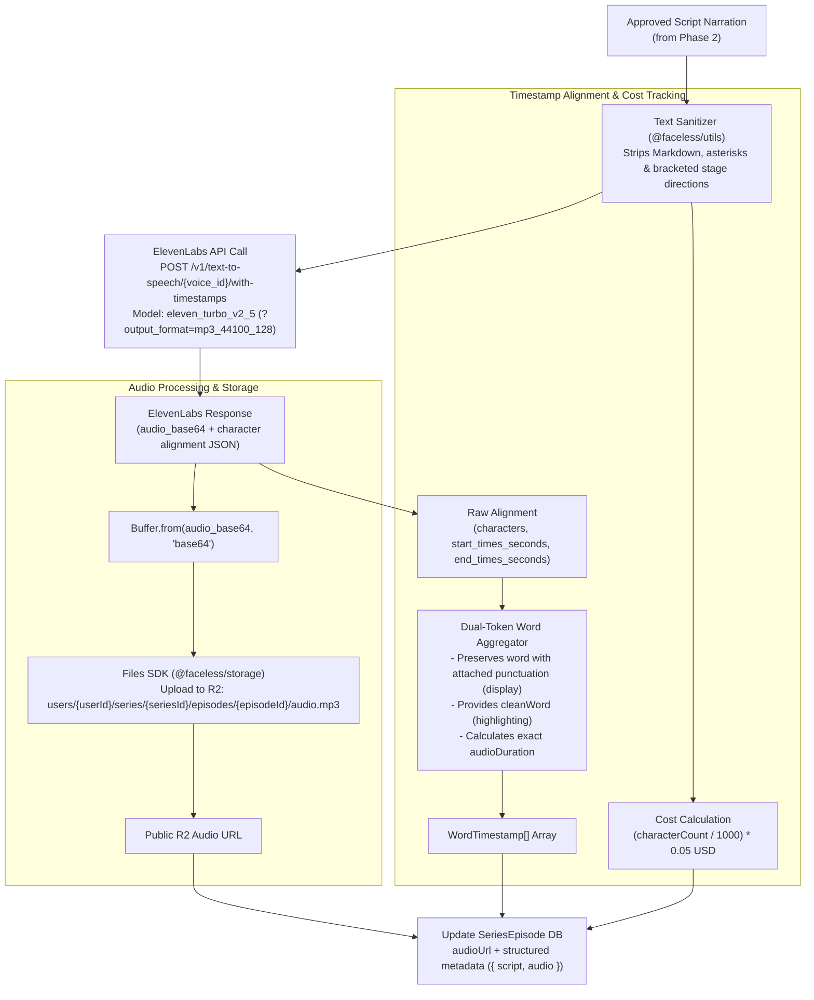

# Phase 3: ElevenLabs Voiceover & Word-Level Timestamps

## 1. Goal & Objectives

Synthesize natural narration voiceovers using **ElevenLabs** exclusively with the high-speed, cost-efficient multilingual model **`eleven_turbo_v2_5`** ($0.05 / 1,000 characters; ~0.5 credits/char). Extract exact character-to-word timestamps from ElevenLabs `/v1/text-to-speech/{voice_id}/with-timestamps` to power synchronized animated captions in Remotion, pre-sanitize script text to eliminate unwanted stage directions, calculate generation costs, and persist audio assets directly to Cloudflare R2 via `@faceless/storage` (Files SDK).

Preserve full multi-tenant isolation, structured non-destructive episode metadata (`{ script, audio }`), dual-token word timestamps (`word` + `cleanWord`), and resilient pipeline recovery (automatic chaining in `generateEpisode` plus a standalone `generateEpisodeAudio` mutation for Studio regeneration).

---

## 2. ElevenLabs Integration Architecture



---

## 3. Detailed Component Specifications

### A. Pre-TTS Script Sanitizer (`packages/utils/src/sanitize-narration-for-tts.ts`)

LLMs often insert stage directions or markdown formatting into narration:

> _"\[Dramatic pause\] Deep inside the tomb... \*whispering\* something stirred."_

If passed untreated, ElevenLabs will speak _"bracket dramatic pause bracket"_ or _"asterisk whispering asterisk"_. The sanitizer strips these artifacts cleanly:

```ts
export const sanitizeNarrationForTts = (rawText: string): string => {
  return (
    rawText
      // Remove bracketed/parenthetical stage directions: [Dramatic pause], (sighs), [whispering]
      .replace(/\[.*?\]|\(.*?\)/gu, "")
      // Remove markdown headers, bold, italics, quotes, backticks
      .replace(/[#*_~`>]/gu, "")
      // Normalize multiple spaces and newlines
      .replace(/\s+/gu, " ")
      .trim()
  );
};
```

---

### B. ElevenLabs Client (`packages/api/src/services/elevenlabs.ts`)

- **Target Endpoint**: `https://api.elevenlabs.io/v1/text-to-speech/{voice_id}/with-timestamps?output_format=mp3_44100_128`
- **Model**: `eleven_turbo_v2_5` (32 languages, 50% cheaper at $0.05 / 1k chars, high-fidelity cadence).
- **Headers**:
  - `xi-api-key`: `process.env.ELEVENLABS_API_KEY`
  - `Content-Type`: `application/json`
- **Request Payload**:
  ```json
  {
    "text": "Cleaned voiceover text...",
    "model_id": "eleven_turbo_v2_5",
    "voice_settings": {
      "stability": 0.45,
      "similarity_boost": 0.8,
      "style": 0.0,
      "use_speaker_boost": true
    }
  }
  ```
- **Response Decoding**:
  ```ts
  const data = await response.json();
  const audioBuffer = Buffer.from(data.audio_base64, "base64");
  ```

---

### C. Dual-Token Word Timestamp Aggregation Algorithm

ElevenLabs returns character-level timestamps:

```ts
export interface RawElevenLabsAlignment {
  characters: string[];
  character_start_times_seconds: number[];
  character_end_times_seconds: number[];
}

export interface WordTimestamp {
  word: string; // Natural with attached punctuation for display (e.g. "unsolved,")
  cleanWord: string; // Alphanumeric stripped for keyword highlights/sync (e.g. "unsolved")
  start: number; // in seconds (e.g. 0.45)
  end: number; // in seconds (e.g. 0.89)
}

export interface ParsedAudioAlignment {
  words: WordTimestamp[];
  audioDuration: number;
}
```

The parser groups character slices on whitespace and assigns both display `word` and animation `cleanWord`:

```ts
const PUNCTUATION_CLEAN_REGEX = /^[^\p{L}\p{N}]+|[^\p{L}\p{N}]+$/gu;

export const parseAlignmentToWords = (
  alignment: RawElevenLabsAlignment
): ParsedAudioAlignment => {
  const words: WordTimestamp[] = [];
  let currentWord = "";
  let wordStart = 0;
  let wordEnd = 0;

  for (let i = 0; i < alignment.characters.length; i++) {
    const char = alignment.characters[i];
    const start = alignment.character_start_times_seconds[i];
    const end = alignment.character_end_times_seconds[i];

    if (char === " " || char === "\n") {
      if (currentWord.trim().length > 0) {
        const trimmed = currentWord.trim();
        const clean = trimmed.replaceAll(PUNCTUATION_CLEAN_REGEX, "");

        words.push({
          word: trimmed,
          cleanWord: clean.length > 0 ? clean : trimmed,
          start: wordStart,
          end: wordEnd,
        });
        currentWord = "";
      }
    } else {
      if (currentWord.length === 0) {
        wordStart = start;
      }
      currentWord += char;
      wordEnd = end;
    }
  }

  if (currentWord.trim().length > 0) {
    const trimmed = currentWord.trim();
    const clean = trimmed.replaceAll(PUNCTUATION_CLEAN_REGEX, "");

    words.push({
      word: trimmed,
      cleanWord: clean.length > 0 ? clean : trimmed,
      start: wordStart,
      end: wordEnd,
    });
  }

  const audioDuration =
    alignment.character_end_times_seconds.length > 0
      ? (alignment.character_end_times_seconds[
          alignment.character_end_times_seconds.length - 1
        ] ?? 0)
      : 0;

  return { words, audioDuration };
};
```

---

### D. Asset Storage via Files SDK (`@faceless/storage`)

Using tenant-isolated Cloudflare R2 pathing:

```ts
const storagePath = `users/${userId}/series/${seriesId}/episodes/${episodeId}/audio.mp3`;

await files.upload(storagePath, audioBuffer, {
  contentType: "audio/mpeg",
});

const audioUrl = await files.url(storagePath);
```

---

## 4. Structured Namespace Database Persistence (`SeriesEpisode.metadata`)

The `SeriesEpisode` Prisma model provides `audioUrl: String?` and `metadata: Json?`. Rather than overwriting the script data generated in Phase 2, we define typed structured namespaces in `@faceless/contracts/series`:

```ts
export interface SeriesEpisodeAudioMetadata {
  audioKey: string;
  audioDuration: number;
  wordTimestamps: WordTimestamp[];
  characterCount: number;
  generationCostUsd: number; // (characterCount / 1000) * 0.05
  voiceId: string;
  modelId: string;
}

export interface SeriesEpisodeMetadata {
  script: GeneratedScriptPayload;
  audio?: SeriesEpisodeAudioMetadata;
}
```

Updating the database without losing script data:

```ts
const existingMetadata =
  (episode.metadata as unknown as SeriesEpisodeMetadata | null) ?? {
    script,
  };

await ctx.db.seriesEpisode.update({
  where: { id: episodeId },
  data: {
    audioUrl,
    metadata: {
      ...existingMetadata,
      audio: {
        audioKey: storagePath,
        audioDuration,
        wordTimestamps: words,
        characterCount: cleanText.length,
        generationCostUsd: Number(
          ((cleanText.length / 1000) * 0.05).toFixed(4)
        ),
        voiceId: series.voiceId,
        modelId: "eleven_turbo_v2_5",
      },
    },
  },
});
```

---

## 5. Failure Recovery & API Procedures

1. **Chained Auto-Synthesis (`series.generateEpisode`)**:
   - Generates script via Phase 2 Eve engine.
   - Immediately synthesizes audio with `series.voiceId`.
   - If audio synthesis throws (e.g. ElevenLabs quota limit or network timeout), the script remains saved, the episode status updates to `FAILED`, and the error is recorded cleanly without crashing DB records.
2. **Dedicated On-Demand Endpoint (`series.generateEpisodeAudio`)**:
   - Allows regenerating voiceover in the Episode Studio (Phase 6), including with an optional `voiceIdOverride`.

---

## 6. Implementation Checklist

- [ ] Add `ELEVENLABS_API_KEY` to `apps/web/.env.schema` and run `bun run env:generate`.
- [ ] Implement `sanitizeNarrationForTts` utility in `@faceless/utils` with unit tests for bracket/markdown removal.
- [ ] Implement `packages/api/src/services/elevenlabs.ts` calling `/with-timestamps` with `eleven_turbo_v2_5`.
- [ ] Implement `parseAlignmentToWords` with dual-token (`word` + `cleanWord`) timestamps.
- [ ] Add `WordTimestamp`, `SeriesEpisodeAudioMetadata`, and `SeriesEpisodeMetadata` types to `@faceless/contracts/series`.
- [ ] Wire audio buffer upload to Cloudflare R2 via `@faceless/storage`.
- [ ] Persist `audioUrl` and structured `metadata: { script, audio }` to `SeriesEpisode`.
- [ ] Add `generateEpisodeAudio` mutation to `packages/api/src/routers/series.ts`.
- [ ] Run `bunx ultracite check` and `bun run check-types` to ensure zero errors.
