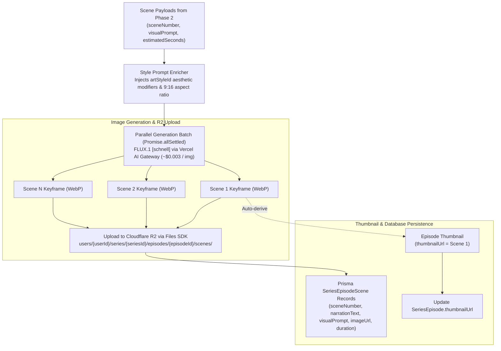

# Phase 4: Visual Asset Generation Pipeline

## 1. Goal & Objectives

Generate 9:16 vertical keyframe images for each scene in the generated script using **FLUX.1 [schnell]** via Vercel AI Gateway (~$0.003 / image, ~1.5s latency). Apply aesthetic prompt modifiers corresponding to the 14 curated styles defined in `SERIES_ART_STYLES`, execute batch image generation concurrently, automatically assign Scene 1 as the episode thumbnail, and persist scene assets directly to Cloudflare R2 via `@faceless/storage`.

---

## 2. Visual Generation Architecture



---

## 3. Art Style Prompt Enricher (14 Curated Styles)

The enricher maps the `series.artStyleId` from `@faceless/contracts/series` to high-fidelity visual tokens for FLUX:

| Contract ID | Style Name | Injected Prompt Modifiers (FLUX.1 [schnell]) |
| :-- | :-- | :-- |
| **`comic`** | Comic | `vintage American comic book style, bold ink line art, halftone dot shading, dynamic action angle, 9:16 vertical poster, vibrant graphic novel aesthetic` |
| **`creepy-comic`** | Creepy Comic | `eerie graphic novel horror aesthetic, deep stark shadows, grotesque ink hatching, desaturated palette with blood red accents, gritty 9:16 vertical` |
| **`modern-cartoon`** | Modern Cartoon | `modern vibrant 2D cartoon style, clean vector outlines, playful bright lighting, contemporary animation studio aesthetic, 9:16` |
| **`disney`** | Disney | `whimsical 3D animation style, expressive character faces, magical glowing ambient lighting, Pixar Disney render, Unreal Engine 5, 9:16` |
| **`anime`** | Anime | `high-end Japanese anime aesthetic, Makoto Shinkai sky and volumetric lighting, crisp cel-shaded lines, cinematic composition, 9:16` |
| **`dark-fantasy`** | Dark Fantasy | `dark gothic fantasy oil painting, Elden Ring and Dark Souls atmosphere, chiaroscuro lighting, eerie fog, gritty textures, 9:16` |
| **`fantastic`** | Fantastic | `surreal fantasy world, vibrant bioluminescent flora, ethereal magical atmosphere, dreamlike epic landscape, 9:16 vertical` |
| **`ghibli`** | Ghibli | `hand-painted Studio Ghibli gouache background, soft nostalgic watercolor textures, lush greenery, pastoral peaceful mood, 9:16` |
| **`lego`** | Lego | `miniature Lego brick diorama, glossy plastic brick textures, macro tilt-shift photography, playful construction, 9:16` |
| **`mythology`** | Mythology | `ancient classical mythological fresco, marble statues, golden hour divine sunlight, epic Hellenic/Norse lore illustration, 9:16` |
| **`painting`** | Painting | `textured classical canvas oil painting, visible expressive impasto brushstrokes, rich warm palette, museum masterpiece, 9:16` |
| **`pixel-art`** | Pixel Art | `retro 16-bit pixel art, detailed pixel shading, nostalgic arcade RPG aesthetic, vibrant color palette, crisp pixel grid, 9:16` |
| **`polaroid`** | Polaroid | `vintage 90s instant Polaroid photograph, film grain, soft lens flare, bleached highlights, nostalgic candid snapshot, 9:16` |
| **`realism`** | Realism | `35mm cinematic photograph, realistic skin textures, natural directional lighting, shallow depth of field, 8k photorealistic, 9:16` |

---

## 4. Detailed Component Plan

### A. Image Generation Service (`packages/api/src/services/ai/image-generator.ts`)

- **Model**: `fal/flux-schnell` or `together/black-forest-labs/FLUX.1-schnell` routed via `AI_GATEWAY_API_KEY`.
- **Dimensions**: $768 \times 1344$ or $864 \times 1536$ (native 9:16 vertical).
- **Format**: Converted to `.webp` before upload for optimal loading speed and minimal R2 bandwidth.

### B. Parallel Batch Execution & Automatic Thumbnail

```ts
export async function generateEpisodeScenes({
  userId,
  seriesId,
  episodeId,
  artStyleId,
  scenes,
}: GenerateScenesParams) {
  const scenePromises = scenes.map(async (scene) => {
    const prompt = enrichPromptWithStyle({
      prompt: scene.visualPrompt,
      artStyleId,
    });

    const imageBuffer = await generateFluxImage({
      prompt,
      aspectRatio: "9:16",
    });

    const storageKey = `users/${userId}/series/${seriesId}/episodes/${episodeId}/scenes/scene_${scene.sceneNumber}.webp`;

    await files.upload(storageKey, imageBuffer, {
      contentType: "image/webp",
    });

    const imageUrl = await files.url(storageKey);

    return {
      sceneNumber: scene.sceneNumber,
      narrationText: scene.narrationChunk,
      visualPrompt: scene.visualPrompt,
      imageUrl,
      imageKey: storageKey,
      duration: scene.estimatedSeconds,
    };
  });

  const generatedScenes = await Promise.all(scenePromises);

  // Auto-derive thumbnail from Scene 1
  const thumbnailUrl = generatedScenes[0]?.imageUrl ?? null;

  return { generatedScenes, thumbnailUrl };
}
```

---

## 5. Database Schema: First-Class `SeriesEpisodeScene`

Creating `SeriesEpisodeScene` in `packages/db/prisma/schema/series.prisma` allows creators in Phase 6 (Episode Studio) to re-generate an individual scene without re-generating the entire video:

```prisma
model SeriesEpisodeScene {
  id            String         @id @default(cuid())
  episodeId     String
  episode       SeriesEpisode  @relation(fields: [episodeId], references: [id], onDelete: Cascade)
  sceneNumber   Int
  narrationText String         @db.Text
  visualPrompt  String         @db.Text
  imageUrl      String
  imageKey      String
  duration      Float
  createdAt     DateTime       @default(now())

  @@unique([episodeId, sceneNumber])
  @@index([episodeId])
  @@map("series_episode_scene")
}
```

And in `SeriesEpisode`:

```prisma
model SeriesEpisode {
  // ... existing fields
  scenes        SeriesEpisodeScene[]
}
```

---

## 6. Implementation Checklist

- [ ] Add `SeriesEpisodeScene` model and relation to `packages/db/prisma/schema/series.prisma`.
- [ ] Build `art-style-enricher.ts` with all 14 curated styles from `SERIES_ART_STYLES`.
- [ ] Implement `packages/api/src/services/ai/image-generator.ts` with FLUX.1 [schnell] 9:16 generation.
- [ ] Implement parallel generation and Cloudflare R2 uploads via `@faceless/storage`.
- [ ] Wire automatic thumbnail assignment (Scene 1 $\rightarrow$ `SeriesEpisode.thumbnailUrl`).
- [ ] Expose single-scene regeneration endpoint: `series.regenerateSceneImage`.
- [ ] Run `bunx ultracite check` and `bun run check-types` to ensure zero errors.
