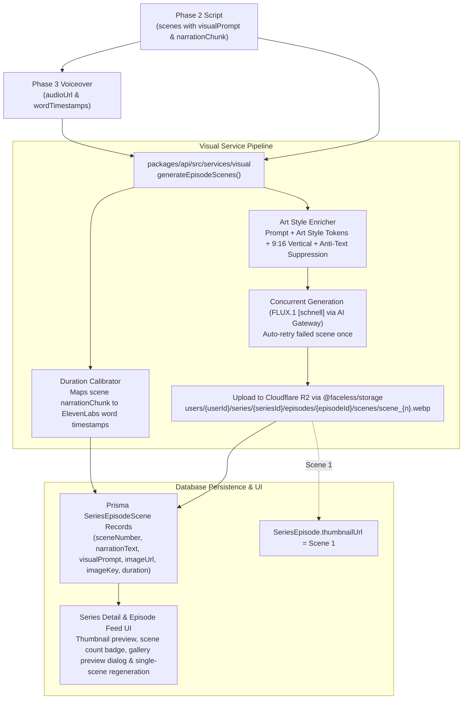

# Phase 4: Visual Asset Generation Pipeline

## 1. Goal & Objectives

Generate 9:16 vertical keyframe images for each scene in the generated script using **FLUX.1 [schnell]** via Vercel AI Gateway (~$0.003 / image, ~1.5s latency). Apply aesthetic prompt modifiers corresponding to the 14 curated styles defined in `SERIES_ART_STYLES`, execute batch image generation concurrently with single-scene auto-retry, calibrate scene durations against ElevenLabs word timestamps, automatically assign Scene 1 as the episode thumbnail, persist scene assets directly to Cloudflare R2 via `@faceless/storage`, store first-class `SeriesEpisodeScene` Prisma records, and expose both end-to-end generation and single-scene regeneration.

---

## 2. Visual Generation Architecture



---

## 3. Art Style Prompt Enricher (14 Curated Styles)

The enricher maps `series.artStyleId` from `@faceless/contracts/series` to high-fidelity visual tokens for FLUX, combined with vertical framing and text suppression directives:

- **Vertical Composition Directive**: `vertical 9:16 portrait aspect ratio, full vertical composition, high production value, cinematic lighting`
- **Text & Clutter Suppression Directive**: `clean visual, no text, no captions, no subtitles, no watermarks, no split screens, no borders`

| Contract ID | Style Name | Injected Prompt Modifiers (FLUX.1 [schnell]) |
| :-- | :-- | :-- |
| **`comic`** | Comic | `vintage American comic book style, bold ink line art, halftone dot shading, dynamic action angle, vibrant graphic novel aesthetic` |
| **`creepy-comic`** | Creepy Comic | `eerie graphic novel horror aesthetic, deep stark shadows, grotesque ink hatching, desaturated palette with blood red accents, gritty atmosphere` |
| **`modern-cartoon`** | Modern Cartoon | `modern vibrant 2D cartoon style, clean vector outlines, playful bright lighting, contemporary animation studio aesthetic` |
| **`disney`** | Disney | `whimsical 3D animation style, expressive character faces, magical glowing ambient lighting, Pixar Disney render, Unreal Engine 5` |
| **`anime`** | Anime | `high-end Japanese anime aesthetic, Makoto Shinkai sky and volumetric lighting, crisp cel-shaded lines, cinematic composition` |
| **`dark-fantasy`** | Dark Fantasy | `dark gothic fantasy oil painting, Elden Ring and Dark Souls atmosphere, chiaroscuro lighting, eerie fog, gritty textures` |
| **`fantastic`** | Fantastic | `surreal fantasy world, vibrant bioluminescent flora, ethereal magical atmosphere, dreamlike epic landscape` |
| **`ghibli`** | Ghibli | `hand-painted Studio Ghibli gouache background, soft nostalgic watercolor textures, lush greenery, pastoral peaceful mood` |
| **`lego`** | Lego | `miniature Lego brick diorama, glossy plastic brick textures, macro tilt-shift photography, playful construction` |
| **`mythology`** | Mythology | `ancient classical mythological fresco, marble statues, golden hour divine sunlight, epic Hellenic/Norse lore illustration` |
| **`painting`** | Painting | `textured classical canvas oil painting, visible expressive impasto brushstrokes, rich warm palette, museum masterpiece` |
| **`pixel-art`** | Pixel Art | `retro 16-bit pixel art, detailed pixel shading, nostalgic arcade RPG aesthetic, vibrant color palette, crisp pixel grid` |
| **`polaroid`** | Polaroid | `vintage 90s instant Polaroid photograph, film grain, soft lens flare, bleached highlights, nostalgic candid snapshot` |
| **`realism`** | Realism | `35mm cinematic photograph, realistic skin textures, natural directional lighting, shallow depth of field, 8k photorealistic` |

---

## 4. Architectural Seam & Implementation Details

### A. Environment Binding

- Add `AI_GATEWAY_API_KEY` to `packages/api/.env.schema`:
  ```ini
  # @import(../../apps/web/, pick=[NODE_ENV, ELEVENLABS_API_KEY, AI_GATEWAY_API_KEY])
  # @generateTsTypes(path=./src/env.ts, exposeEnv=local)
  ```
- Run `bun run env:generate` to keep typed `ENV.AI_GATEWAY_API_KEY` available in `@faceless/api`.

### B. Visual Domain Service (`packages/api/src/services/visual/`)

- **`index.ts`**: Entry point exposing `generateEpisodeScenes` and `regenerateSingleScene`.
- **`enricher.ts`**: Pure function mapping `artStyleId` + scene prompt into enriched FLUX prompts.
- **`calibrator.ts`**: Aligns each scene's `narrationChunk` with ElevenLabs `wordTimestamps` to compute exact start/end `duration` (in seconds).
- **Model**: `createGatewayProvider({ apiKey: ENV.AI_GATEWAY_API_KEY }).imageModel("black-forest-labs/flux-schnell")` combined with `generateImage` from `ai`.
- **Upload**: Directly upload image buffer to Cloudflare R2 via `@faceless/storage` under: `users/${userId}/series/${seriesId}/episodes/${episodeId}/scenes/scene_${sceneNumber}.webp`

### C. Concurrency & Retry Strategy

1. Scenes are generated concurrently with `Promise.allSettled`.
2. Any scene that fails (network timeout/rate limit) is automatically retried once.
3. If all scenes succeed, they are persisted to `SeriesEpisodeScene`, Scene 1 is assigned to `SeriesEpisode.thumbnailUrl`, and episode status moves to `READY_FOR_REVIEW`.
4. If a scene still fails after retry, successful scenes are persisted, the episode is set to `status: "FAILED"` with an actionable error message, and single-scene regeneration remains available.

---

## 5. Database Schema: First-Class `SeriesEpisodeScene`

Add `SeriesEpisodeScene` model to `packages/db/prisma/schema/series.prisma`:

```prisma
model SeriesEpisodeScene {
  id            String         @id @default(cuid())
  episodeId     String
  episode       SeriesEpisode  @relation(fields: [episodeId], references: [id], onDelete: Cascade)
  sceneNumber   Int
  narrationText String         @db.Text
  visualPrompt  String         @db.Text
  imageUrl      String
  imageKey      String
  duration      Float
  createdAt     DateTime       @default(now())
  updatedAt     DateTime       @updatedAt

  @@unique([episodeId, sceneNumber])
  @@index([episodeId])
  @@map("series_episode_scene")
}
```

Update `SeriesEpisode` in `packages/db/prisma/schema/series.prisma`:

```prisma
model SeriesEpisode {
  // ... existing fields
  scenes        SeriesEpisodeScene[]
}
```

---

## 6. API Procedures & Contracts (`packages/contracts` and `packages/api`)

1. **`generateEpisode` (Extended Pipeline)**:
   - Scriptwriter $\rightarrow$ ElevenLabs Audio $\rightarrow$ Scene Visual Generation & R2 Upload $\rightarrow$ Set `thumbnailUrl` = Scene 1.
2. **`regenerateEpisodeScene` (New Procedure)**:
   - Input: `{ episodeId: string, sceneNumber: number, promptOverride?: string }`
   - Re-generates single scene keyframe, uploads to R2, updates `SeriesEpisodeScene` record (and updates `thumbnailUrl` if `sceneNumber === 1`).
3. **`getSeriesById` (Contract Update)**:
   - Include `scenes` array in episode data:
     ```ts
     scenes: z.array(
       z.object({
         id: z.string(),
         sceneNumber: z.number(),
         narrationText: z.string(),
         visualPrompt: z.string(),
         imageUrl: z.string(),
         duration: z.number(),
       })
     );
     ```

---

## 7. Web UI Experience (`apps/web`)

1. **Episode Card**:
   - Render `thumbnailUrl` as the episode card preview image with fallback icon.
   - Add Scene badge: `🖼️ {ep.scenes.length} Scenes`.
2. **Scene Gallery Dialog**:
   - Add a "Preview Scenes" action opening a modal drawer.
   - Shows all generated scene keyframes in 9:16 vertical cards with their narration chunks and durations.
   - Includes a "Regenerate" button per scene triggering `trpc.series.regenerateEpisodeScene` with live mutation state and automatic `onSettled` query invalidation.

---

## 8. Implementation Checklist

- [x] Update `packages/api/.env.schema` to import `AI_GATEWAY_API_KEY` and run `bun run env:generate`.
- [x] Add `SeriesEpisodeScene` to `packages/db/prisma/schema/series.prisma` and run `bun run db:push`.
- [x] Create `packages/api/src/services/visual/`:
  - `enricher.ts` (14 art styles + vertical composition + anti-text tokens)
  - `calibrator.ts` (align scene narration with word timestamps)
  - `index.ts` (FLUX image generation via AI Gateway + R2 upload + retry logic)
- [x] Add contract schemas in `packages/contracts/src/series.ts` (`regenerateEpisodeSceneInputSchema`, output schema, and updated `getSeriesByIdOutputSchema`).
- [x] Update `packages/api/src/routers/series.ts`:
  - Chain visual generation into `generateEpisode`.
  - Implement `regenerateEpisodeScene` procedure.
  - Return `scenes` relation in `byId`.
- [x] Update `apps/web/src/app/(protected)/series/[id]/_components/series-episodes-feed.tsx` with thumbnail preview and scene gallery dialog.
- [x] Add unit tests for `enricher.ts` and `calibrator.ts`.
- [x] Verify `bunx vitest run`, `bun run check-types`, and `bunx ultracite check`.
