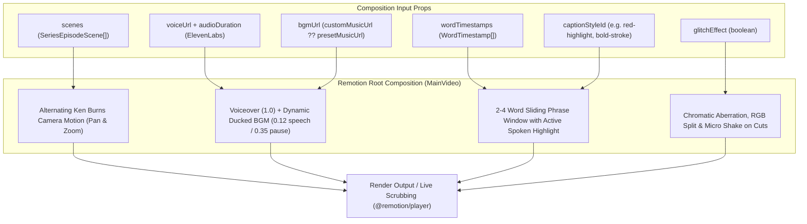

# Phase 5: Remotion Video Composition & Motion Engine

## 1. Goal & Objectives

Build a high-performance, modular **Remotion** video engine (`remotion.dev`). Compose 9:16 vertical videos ($1080 \times 1920$ @ 30 FPS) uniting scene keyframes with alternating Ken Burns camera motion, a high-retention 2–4 word sliding caption engine supporting all 9 presets in `SERIES_CAPTION_STYLES`, an automated audio ducking mixer for background music, and a chromatic aberration glitch shader for horror/thriller series.

---

## 2. Remotion Composition Architecture



---

## 3. Detailed Component Plan

### A. Folder Organization (Client & Player Safe)

To avoid bundling conflicts between client components and Node.js rendering:

```
apps/web/src/remotion/
├── compositions/
│   ├── main-video.tsx           # Root composition orchestrating all layers
│   ├── scene-sequence.tsx       # Alternating Ken Burns pan/zoom on scene images
│   ├── caption-layer.tsx        # 2-4 word sliding window caption renderer
│   ├── audio-mixer.tsx          # Dynamic audio ducking controller
│   └── glitch-shader.tsx        # Chromatic aberration & scanline overlay
├── styles/
│   └── caption-presets.ts       # CSS & spring definitions for 9 caption styles
└── types.ts                     # Remotion composition input props interface
```

---

### B. Composition Specifications

- **Canvas Dimensions**: $1080 \times 1920$ (native 9:16 vertical).
- **Frame Rate**: 30 FPS.
- **Dynamic Frame Duration**: $$\text{durationInFrames} = \lceil \text{audioDurationSeconds} \times 30 \rceil$$

---

### C. Alternating Ken Burns Camera Motion (`scene-sequence.tsx`)

To keep viewer retention high and eliminate static image fatigue, each scene applies an alternating directional camera motion:

- **Scene 1 (Even index)**: Slow zoom-in ($1.0 \rightarrow 1.15$) with slight downward drift.
- **Scene 2 (Odd index)**: Slow zoom-out ($1.15 \rightarrow 1.0$) with slight upward pan.

```tsx
const sceneDurationFrames = Math.ceil(scene.duration * fps);
const isEven = sceneIndex % 2 === 0;

const scale = interpolate(
  frame,
  [0, sceneDurationFrames],
  isEven ? [1.0, 1.15] : [1.15, 1.0],
  { extrapolateRight: "clamp" }
);

const translateY = interpolate(
  frame,
  [0, sceneDurationFrames],
  isEven ? [0, -30] : [-30, 0],
  { extrapolateRight: "clamp" }
);
```

---

### D. Caption Engine: 2–4 Word Sliding Window (`caption-layer.tsx`)

Rather than flashing a single word (too jumpy) or displaying a full paragraph (too cluttered), captions render in **2 to 4 word phrases**:

1. **Window Calculation**: Find the active word based on `currentSeconds = frame / 30`. Compute the current phrase chunk (the active word plus 1–2 surrounding words).
2. **Preset Styling (`SERIES_CAPTION_STYLES`)**:

| Preset ID | Style Name | Visual Styling & Animation |
| :-- | :-- | :-- |
| **`bold-stroke`** | Bold Stroke | Heavy black outline (`-webkit-text-stroke: 3px #000`), active word scales with spring bounce (`scale: 1.18`). |
| **`red-highlight`** | Red Highlight | Spoken word illuminates in glowing crimson (`#ef4444`) with drop shadow; surrounding words remain white. |
| **`sleek`** | Sleek | Clean minimalist typography with soft fade-in and smooth slide entrance. |
| **`karaoke`** | Karaoke | Horizontal wipe gradient filling each word from left to right in sync with syllable duration. |
| **`majestic`** | Majestic | Elegant serif with golden glow and subtle royal gold particle accents. |
| **`beast`** | Beast | Massive, all-caps centered high-impact typography with subtle screen shake on emphasis. |
| **`elegant`** | Elegant | Clean letter-spacing, cinematic tracking, and soft blur entrance. |
| **`pixel`** | Pixel | Retro 8-bit monospace font with neon cyan and magenta outlines. |
| **`clarity`** | Clarity | Dark translucent pill backdrop behind the active phrase for maximum legibility over complex backgrounds. |

---

### E. Dynamic Audio Ducking Mixer (`audio-mixer.tsx`)

Automatically prioritizes `series.customMusicUrl` if uploaded, or falls back to `SERIES_MUSIC_PRESETS`:

- **Voiceover**: `<Audio src={voiceUrl} volume={1.0} />`
- **Background Music**: Dynamic volume calculation:
  ```tsx
  // Check if speech is currently active
  const isSpeaking = wordTimestamps.some(
    (w) => currentTime >= w.start - 0.1 && currentTime <= w.end + 0.1
  );

  // Smoothly duck volume during speech, ramp up during pauses (> 0.4s)
  const bgmVolume = interpolate(
    isSpeaking ? 1 : 0,
    [0, 1],
    [0.32, 0.12], // 0.32 during pauses, 0.12 during voiceover
    { extrapolateRight: "clamp" }
  );

  <Audio src={bgmUrl} volume={bgmVolume} loop />;
  ```

---

### F. Glitch Effect Overlay (`glitch-shader.tsx`)

When `glitchEffect: true` is selected:

- **Scene Transition Triggers**: During frames $0{-}6$ of every scene cut, applies an SVG chromatic aberration filter (shifting Red and Cyan channels horizontally by 8–14px).
- **Scanlines**: Light horizontal CRT scanline overlay with subtle vignette.
- **Shake**: Micro-jitter on the scene camera using `spring()`.

---

## 4. Implementation Checklist

- [ ] Install Remotion dependencies (`remotion`, `@remotion/player`, `@remotion/media-utils`).
- [ ] Scaffold `apps/web/src/remotion/compositions/` directory.
- [ ] Implement `MainVideo` root composition with dynamic frame duration prop.
- [ ] Build `SceneSequence` with alternating Ken Burns zoom/pan transitions.
- [ ] Build `CaptionLayer` with 2–4 word sliding window supporting all 9 presets.
- [ ] Build `AudioMixer` with real-time speech ducking.
- [ ] Build `GlitchShader` chromatic aberration overlay.
- [ ] Test composition in browser using `@remotion/player`.
- [ ] Run `bunx ultracite check` and `bun run check-types` to ensure zero regressions.
