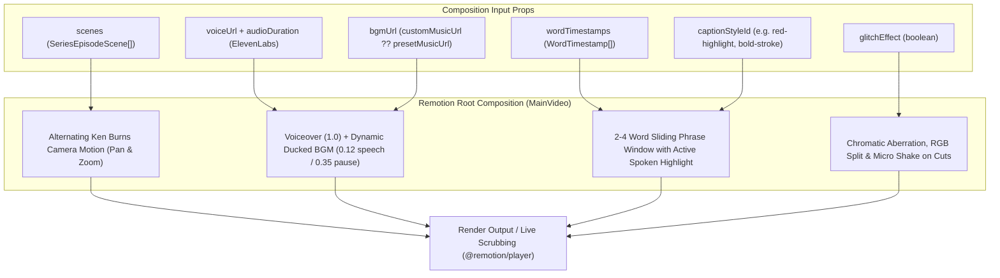

# Phase 5: Remotion Video Composition & Motion Engine

## 1. Goal & Objectives

Build a high-performance, modular **Remotion** video engine (`remotion.dev`). Compose 9:16 vertical videos ($1080 \times 1920$ @ 30 FPS) uniting scene keyframes with alternating Ken Burns camera motion, a high-retention 2–4 word sliding caption engine supporting all 9 presets in `SERIES_CAPTION_STYLES`, an automated audio ducking mixer for background music, and a chromatic aberration glitch shader for horror/thriller series.

---

## 2. Remotion Composition Architecture



---

## 3. Detailed Component Plan

### A. Folder Organization (Dedicated `@faceless/remotion` Package)

To ensure clean unidirectional leverage across the monorepo, avoid cross-boundary imports between `apps/web` and backend renderers, and provide an isolated test surface:

```
packages/remotion/
├── package.json                 # Name: @faceless/remotion
├── remotion.config.ts           # Standalone Remotion studio config
├── src/
│   ├── index.ts                 # Package entry point exporting compositions, types & helpers
│   ├── root.tsx                 # Remotion Root definition with <Composition> registration
│   ├── compositions/
│   │   ├── main-video.tsx       # Root composition orchestrating scene, audio, caption, and glitch layers
│   │   ├── scene-sequence.tsx   # Alternating Ken Burns pan/zoom on scene images with hard cuts
│   │   ├── caption-layer.tsx    # 2-4 word sliding window caption renderer
│   │   ├── audio-mixer.tsx      # Pre-computed envelope audio ducking controller
│   │   └── glitch-shader.tsx    # Chromatic aberration & micro-shake overlay
│   ├── core/
│   │   ├── caption-window.ts    # Pure punctuation-aware 2-4 word sliding window calculator
│   │   └── speech-envelope.ts   # Pure speech interval merger and volume curve generator
│   ├── styles/
│   │   ├── caption-presets.ts   # Typography & animation definitions for 9 caption styles
│   │   └── fonts.ts             # Deterministic font loaders via @remotion/google-fonts
│   ├── types.ts                 # VideoCompositionProps & layer interface contracts
│   └── __tests__/
│       ├── caption-window.test.ts # Vitest suite for punctuation breaks & sliding windows
│       └── speech-envelope.test.ts # Vitest suite for speech interval merging & ducking
```

---

### B. Composition Specifications

- **Canvas Dimensions**: $1080 \times 1920$ (native 9:16 vertical).
- **Frame Rate**: 30 FPS.
- **Dynamic Frame Duration**: $$\text{durationInFrames} = \lceil \text{audioDurationSeconds} \times 30 \rceil$$

---

### C. Alternating Ken Burns Camera Motion (`scene-sequence.tsx`)

To keep viewer retention high and eliminate static image fatigue, each scene applies an alternating directional camera motion with instant hard cuts:

- **Scene 1 (Even index)**: Slow zoom-in ($1.0 \rightarrow 1.15$) with slight downward drift.
- **Scene 2 (Odd index)**: Slow zoom-out ($1.15 \rightarrow 1.0$) with slight upward pan.

```tsx
const sceneDurationFrames = Math.ceil(scene.duration * fps);
const isEven = sceneIndex % 2 === 0;

const scale = interpolate(
  frame,
  [0, sceneDurationFrames],
  isEven ? [1.0, 1.15] : [1.15, 1.0],
  { extrapolateRight: "clamp" }
);

const translateY = interpolate(
  frame,
  [0, sceneDurationFrames],
  isEven ? [0, -30] : [-30, 0],
  { extrapolateRight: "clamp" }
);
```

---

### D. Caption Engine: Punctuation-Aware 2–4 Word Sliding Window (`caption-layer.tsx`)

Rather than flashing a single word (too jumpy) or displaying a full paragraph (too cluttered), captions render in **2 to 4 word natural speech phrases**:

1. **Punctuation-Aware Window Calculation (`caption-window.ts`)**:
   - Segments text at sentence and clause punctuation boundaries (`.`, `?`, `!`, `,`).
   - Ensures no phrase awkwardly straddles across sentence boundaries (e.g. "he vanished. And then").
   - Computes active word highlighting index and phrase start/end timestamps.
2. **Deterministic Font Loading (`fonts.ts`)**:
   - Uses `@remotion/google-fonts` to load typography (Montserrat, Anton, Cinzel, Press Start 2P) upfront to guarantee zero FOIT and pixel-perfect rendering across browser player and server renderers.
3. **Preset Styling (`SERIES_CAPTION_STYLES`)**:

| Preset ID | Style Name | Visual Styling & Animation | Font Family |
| :-- | :-- | :-- | :-- |
| **`bold-stroke`** | Bold Stroke | Heavy black outline (`-webkit-text-stroke: 3px #000`), active word scales with spring bounce (`scale: 1.18`). | Montserrat Black |
| **`red-highlight`** | Red Highlight | Spoken word illuminates in glowing crimson (`#ef4444`) with drop shadow; surrounding words remain white. | Montserrat ExtraBold |
| **`sleek`** | Sleek | Clean minimalist typography with soft fade-in and smooth slide entrance. | Inter Bold |
| **`karaoke`** | Karaoke | Horizontal wipe gradient filling each word from left to right in sync with syllable duration. | Montserrat Bold |
| **`majestic`** | Majestic | Elegant serif with golden glow and subtle royal gold particle accents. | Cinzel Decorative |
| **`beast`** | Beast | Massive, all-caps centered high-impact typography with subtle screen shake on emphasis. | Anton |
| **`elegant`** | Elegant | Clean letter-spacing, cinematic tracking, and soft blur entrance. | Cormorant Garamond |
| **`pixel`** | Pixel | Retro 8-bit monospace font with neon cyan and magenta outlines. | Press Start 2P |
| **`clarity`** | Clarity | Dark translucent pill backdrop behind the active phrase for maximum legibility over complex backgrounds. | Inter SemiBold |

---

### E. Pre-Computed Audio Ducking Envelope (`audio-mixer.tsx`)

To avoid running $O(N)$ timestamp scans on every single frame ($1,800$ checks per 60s video), speech intervals are merged into a continuous envelope once upfront:

1. **`computeSpeechIntervals(wordTimestamps)`**: Merges adjacent word timestamps separated by $< 0.35$s into contiguous speech ranges.
2. **`resolveDuckingVolume(currentTime, intervals)`**: Lookups in $O(\log M)$ time:
   - Voiceover speech active: smooth ducking to `0.12`.
   - Voiceover pause ($> 0.35$s): gentle swell to `0.32`.
3. **Audio Tracks**:
   - Voiceover track: `<Audio src={voiceUrl} volume={1.0} />`
   - Background music track: `<Audio src={bgmUrl} volume={duckedVolume} loop />`

---

### F. Glitch Effect Overlay (`glitch-shader.tsx`)

When `glitchEffect: true` is selected:

- **Scene Transition Flash**: During frames $0{-}6$ of every scene cut, applies an SVG chromatic aberration filter (shifting Red and Cyan channels horizontally by 8–14px).
- **Scanlines**: Light horizontal CRT scanline overlay with subtle vignette.
- **Shake**: Micro-jitter on the scene camera using `spring()`.

---

## 4. Implementation Checklist

- [x] Scaffold `packages/remotion` package with `package.json`, `tsconfig.json`, and Turborepo integration.
- [x] Install Remotion core dependencies (`remotion`, `@remotion/media-utils`, `@remotion/google-fonts`, and dev dependencies).
- [x] Implement pure `speech-envelope.ts` and add unit tests (`speech-envelope.test.ts`).
- [x] Implement pure `caption-window.ts` with punctuation-aware chunking and add unit tests (`caption-window.test.ts`).
- [x] Implement `fonts.ts` and `caption-presets.ts` supporting all 9 caption presets.
- [x] Build `SceneSequence` with alternating Ken Burns camera pan/zoom and hard cut transitions.
- [x] Build `AudioMixer` with pre-computed envelope audio ducking.
- [x] Build `GlitchShader` chromatic aberration overlay.
- [x] Build `MainVideo` root composition orchestrating all layers.
- [x] Configure `remotion preview` standalone studio script in `packages/remotion`.
- [x] Integrate `@faceless/remotion` into `apps/web`.
- [x] Run `bunx vitest run`, `bun run check-types`, and `bunx ultracite check`.
