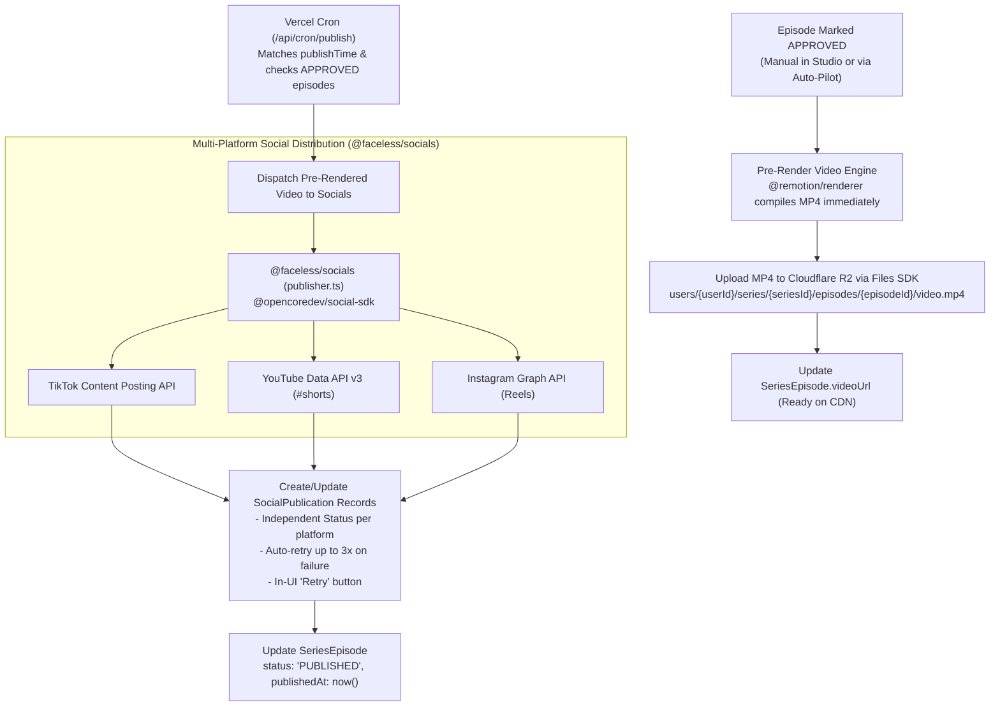

# Phase 7: Server Rendering & Social Publishing Pipeline

## 1. Goal & Objectives

Execute server-side video rendering using **`@remotion/renderer`** to export production-ready `.mp4` video files ($1080 \times 1920$ H.264 / AAC) and persist them to Cloudflare R2 via `@faceless/storage`. Automate scheduled publishing based on the series `publishTime` using a secure Vercel Cron endpoint (`/api/cron/publish`) and dispatching videos to connected TikTok, YouTube Shorts, and Instagram accounts via the existing **`@faceless/socials`** publisher.

---

## 2. Server Rendering & Distribution Flow



---

## 3. Detailed Component Plan

### A. Video Renderer Architecture (`VideoRendererService` Adapter Pattern)

To ensure zero vendor lock-in and seamless transition between local development and high-throughput serverless rendering, we employ an adapter pattern:

```ts
export interface VideoRendererService {
  renderVideo(params: RenderParams): Promise<{ videoUrl: string }>;
}
```

- **`LocalRemotionRenderer`** (Default for local development & staging):
  - Uses `@remotion/bundler` and `@remotion/renderer` in-process.
  - Generates `.mp4` into `/tmp`, streams upload to Cloudflare R2 via Files SDK, and unlinks temporary files.
- **`RemotionLambdaRenderer`** (Production ready):
  - Offloads rendering to AWS Lambda via `@remotion/lambda` for sub-15s distributed rendering without container memory/timeout constraints.

```ts
import { files } from "@faceless/storage";
import { bundle } from "@remotion/bundler";
import { renderMedia, selectComposition } from "@remotion/renderer";

export async function renderAndUploadEpisodeVideo({
  userId,
  seriesId,
  episodeId,
  compositionProps,
}: RenderParams): Promise<string> {
  const bundleLocation = await bundle({
    entryPoint: "apps/web/src/remotion/index.ts",
  });

  const composition = await selectComposition({
    serveUrl: bundleLocation,
    id: "MainVideo",
    inputProps: compositionProps,
  });

  const tempOutputPath = `/tmp/episode_${episodeId}.mp4`;

  await renderMedia({
    composition,
    serveUrl: bundleLocation,
    codec: "h264",
    outputLocation: tempOutputPath,
    inputProps: compositionProps,
    concurrency: 4,
  });

  // Upload to Cloudflare R2 via Files SDK
  const videoKey = `users/${userId}/series/${seriesId}/episodes/${episodeId}/video.mp4`;
  const videoBuffer = await fs.promises.readFile(tempOutputPath);

  await files.upload(videoKey, videoBuffer, {
    contentType: "video/mp4",
  });

  // Cleanup temp file
  await fs.promises.unlink(tempOutputPath);

  return await files.url(videoKey);
}
```

---

### B. Credit & Quota Consumption Policy

- **Reserve at Trigger**: When an episode generation is initiated (either via automated cron or manual "Generate Episode Now"), 1 episode quota is reserved from the user's active billing period.
- **Automatic Refund on Fatal Failure**: If the generation pipeline fails after all retries (e.g. downstream ElevenLabs/FLUX outage), the reserved credit is immediately refunded to the user's quota, and the episode is marked `FAILED` with actionable error details.

---

### B. Multi-Platform Auto-Posting via Existing `@faceless/socials`

[`packages/socials/src/publisher.ts`](file:///Users/dzulhelmy/Desktop/faceless/packages/socials/src/publisher.ts) already handles platform conversions and payload construction using `@opencoredev/social-sdk`:

```ts
import { publishVideoToTargets } from "@faceless/socials";

const result = await publishVideoToTargets({
  client: socialClient,
  input: {
    videoUrl: episode.videoUrl,
    title: episode.title,
    description: `${episode.title} #shorts #viral`,
  },
  targets: connectedAccounts.map((account) => ({
    platform: account.platform.toLowerCase(),
    accountId: account.platformUserId,
    // platform-specific options (e.g. visibility, shareToFeed)
  })),
});
```

---

### C. Existing Database Model: `SocialPublication`

Rather than adding a duplicate model, we leverage the existing [`SocialPublication`](file:///Users/dzulhelmy/Desktop/faceless/packages/db/prisma/schema/social.prisma) model:

```prisma
model SocialPublication {
  id                 String           @id @default(cuid())
  socialConnectionId String
  episodeId          String?
  platform           SocialPlatform   // TIKTOK | YOUTUBE | INSTAGRAM
  externalPostId     String?
  status             String           // SUCCESS | FAILED
  error              String?
  metadata           Json?
  publishedAt        DateTime?
  createdAt          DateTime         @default(now())
  updatedAt          DateTime         @updatedAt

  connection         SocialConnection @relation(fields: [socialConnectionId], references: [id], onDelete: Cascade)
  episode            SeriesEpisode?   @relation(fields: [episodeId], references: [id], onDelete: SetNull)

  @@index([socialConnectionId])
  @@index([episodeId])
  @@map("social_publication")
}
```

---

### D. Automated Vercel Cron Worker (`apps/web/src/app/api/cron/publish/route.ts`)

- Protected with standard `Authorization: Bearer ${process.env.CRON_SECRET}`.
- Triggered on an automated schedule (e.g. `*/15 * * * *` in `vercel.json`):
  1. Finds all `Series` where `status = "ACTIVE"`.
  2. Matches current hour against series `publishTime` (e.g. `12:00 PM`).
  3. Finds the next `SeriesEpisode` where `status = "APPROVED"`.
  4. Renders video if `videoUrl` is null.
  5. Dispatches video to connected social accounts.
  6. Creates `SocialPublication` records.
  7. Updates `SeriesEpisode.status = "PUBLISHED"` and `publishedAt = new Date()`.

---

## 4. Implementation Checklist

- [ ] Install `@remotion/bundler` and `@remotion/renderer` in backend rendering package or service.
- [ ] Implement `renderAndUploadEpisodeVideo` with Cloudflare R2 upload integration.
- [ ] Connect `publishVideoToTargets` from `@faceless/socials` to episode publisher.
- [ ] Record delivery outcomes in `SocialPublication` records.
- [ ] Build secure `/api/cron/publish` endpoint with `CRON_SECRET` authorization.
- [ ] Add `vercel.json` cron schedule for continuous publishing.
- [ ] Run `bunx ultracite check` and `bun run check-types` to ensure zero regressions.
